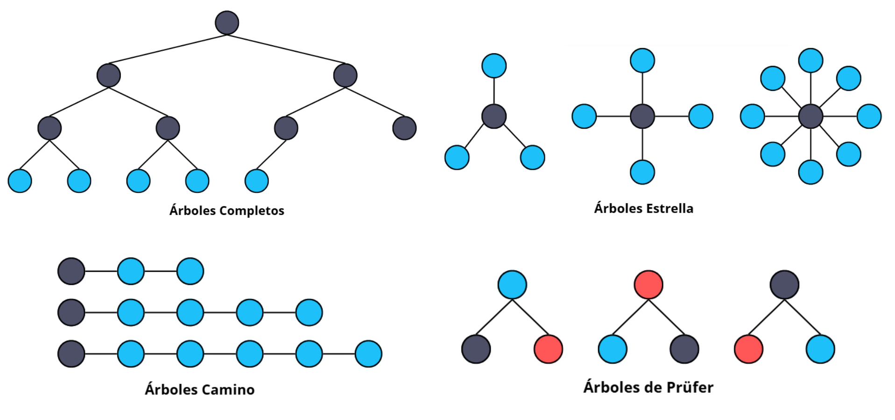
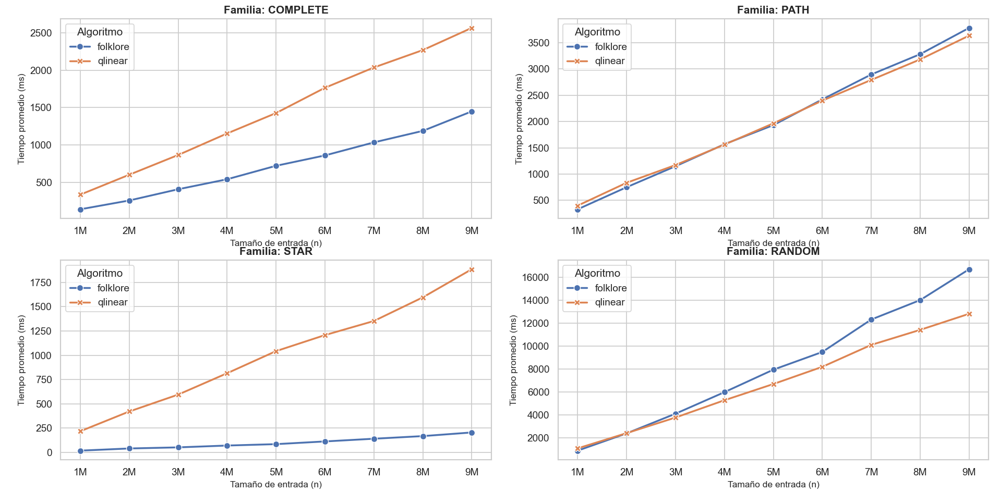
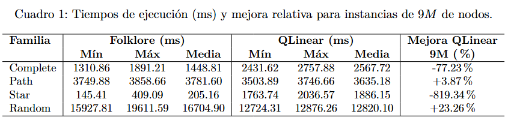

# Centroid Decomposition en tiempo O(N log log N)

El repositorio busca ser una implementación parcial del algoritmo de Della Giustina para la descomposición por centroide en tiempo lineal. En particular, la implementación se queda en la cota N log log N del paper.

Esto significa que la implementación se enfoca principalmente en la técnica de cobertura planteada para alcanzar la cota N log log N, y en comparar dicha implementación con el algoritmo clásico sobre 4 familias de árboles.

Las familias de árboles utilizadas para la comparación son:
- Árboles estrella (star): donde solo un vértice tiene grado mayor a 1.
- Árboles camino (path): donde todos tienen grado 2 a excepción de los extremos (hojas), que tienen grado 1.
- Árboles completos (complete): árboles binarios tales que todos los niveles están completos a excepción del último, que debe estar lleno de izquierda a derecha.
- Árboles aleatoriamente uniformes (random): árboles aleatorios generados a partir de las secuencias de Prüfer para árboles uniformemente aleatorios etiquetados.



Ejemplo de cada una de las cuatro familias de árboles utilizadas.


## Sobre la estructura del repositorio

La organización de las carpetas es la siguiente.

```
Repositorio
- generator/       # Códigos relacionados a la generación de los árboles
- include/         # Cabeceras para las implementaciones principales del repositorio
  - centroid_decomposition_folklore.h        # Cabecera del algoritmo clásico
  - centroid_decomposition_quasi_linear.h    # Cabecera del algoritmo estudiado
  - graph_utils.h      # No relevante, cabecera de algunas aplicaciones del árbol de centroides
- src/
  - centroid_decomposition_folklore.cpp        # Implementación del algoritmo clásico
  - centroid_decomposition_quasi_linear.cpp    # Implementación del algoritmo estudiado
  - graph_utils.cpp      # No relevante, implementación de algunas aplicaciones del árbol de centroides
  - benchmark.cpp        # Orquestador de comandos para realizar los benchmarks
  - main.cpp             # Lugar donde puedes aplicar con libertad ambos centroides y experimentar
- benchmark.sh           # Script para realizar los benchmarks
- build.sh               # Script para ejecutar el código main.cpp
- Informe.pdf            # Informe asociado al estudio y repositorio
- PPT.pdf                # Presentación utilizada durante la exposición
```


## Sobre cómo usar el repositorio

Los scripts bash están pensados para ser usados sobre una máquina compatible con Linux.

build.sh se utiliza tal cual, llamándolo como bash build.sh en la terminal.

El script de benchmark es más dinámico.

Uso:
bash benchmark.sh --help
  bash benchmark.sh -random [-n 1000,10000,100000] [-reps 5] [-seed 42] [-csv output/benchmark.csv] [-validate]
  bash benchmark.sh -star -n 1000000
  bash benchmark.sh -complete -n 100000
  bash benchmark.sh -path -n 50000

- random, star, path, complete: sobre qué familia de árboles realizar el benchmark.
- n: sobre cuántos nodos tendrá el árbol; puedes colocar un único valor para n o varios separados por ",".

- reps: las veces que se repetirá la construcción bajo las indicaciones anteriores.

- seed: principalmente para la familia random, relacionado a la semilla de generación, por defecto 42.

- csv: relacionado a la ubicación de exportación de la información.


## Sobre los resultados obtenidos



Gráfica de tiempos obtenidos por familia.



Cuadro de tiempos por familia (mínimo, media y máximo).


## Aplicaciones desarrolladas

Debido a que un árbol de centroides de un grafo cumple propiedades especiales, y que tanto la descomposición clásica como la quasi linear no cambian esas propiedades, desarrollamos —a modo de "dato curioso" primordialmente— la solución de Xenia and Tree de Codeforces.


## Sobre el uso de IA:

La IA se usó para generar el código relacionado a los benchmarks, la generación de árboles y los scripts build.sh y benchmark.sh.

Sobra decir que tuvo su revisión correspondiente.

## Anexo

Paper en el que se basa el repositorio:

Della Giustina, D., Prezza, N., & Venturini, R. (2019). A New Linear-Time Algorithm for
Centroid Decomposition. String Processing and Information Retrieval (SPIRE 2019),
274-282. https://doi.org/10.1007/978-3-030-32686-9_20
